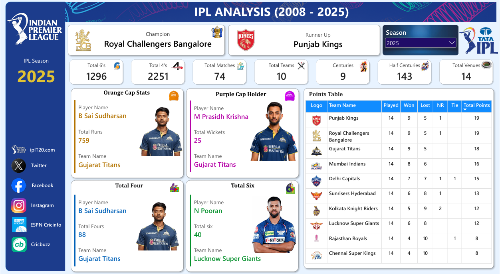

# 🏏 IPL Analysis Dashboard (2008–2025) | Power BI

## 📌 Project Overview

The **IPL Analysis Dashboard** is an interactive data analytics project built using Microsoft Power BI to analyze the Indian Premier League (IPL) across 18 seasons, from 2008 to 2025.

The project transforms raw cricket datasets into meaningful insights through interactive visualizations, DAX measures, and data modeling. It enables users to explore team standings, match statistics, player achievements, and batting and bowling performances across different IPL seasons.

## 🎯 Project Objectives

- Analyze IPL statistics across seasons from 2008 to 2025.
- Identify top-performing players based on runs, wickets, fours, and sixes.
- Compare team performance using wins, losses, and points tables.
- Explore match statistics and season-wise trends.
- Build an interactive dashboard to make cricket data easier to understand.

## 🛠️ Tools & Technologies

- **Microsoft Power BI** — Dashboard development and data visualization
- **DAX** — Measures and analytical calculations
- **Power Query** — Data cleaning and transformation
- **Data Modeling** — Relationships between match, ball-by-ball, player, and team datasets
- **CSV** — Source data files

## 📊 Dashboard Preview

### IPL Analysis Dashboard — 2008 to 2025

The dashboard includes a season selector that allows users to explore statistics for individual IPL seasons. The screenshot above shows the 2025 season selected.

## 📈 Key Dashboard Features

### 1. Season Overview

Provides a summary of the selected IPL season through key performance indicators:

- Total 6s
- Total 4s
- Total Matches
- Total Teams
- Centuries
- Half Centuries
- Total Venues

### 2. Orange Cap Stats

Highlights the leading run-scorer for the selected season, including:

- Player Name
- Total Runs
- Team Name

### 3. Purple Cap Holder

Displays the leading wicket-taker for the selected season, including:

- Player Name
- Total Wickets
- Team Name

### 4. Total Four Leaderboard

Identifies the player with the highest number of fours in the selected season, along with their total fours and team.

### 5. Total Six Leaderboard

Highlights the player with the highest number of sixes in the selected season, along with their total sixes and team.

### 6. IPL Points Table

Compares team standings using:

- Team Logo
- Team Name
- Matches Played
- Matches Won
- Matches Lost
- No Results (NR)
- Ties
- Total Points

### 7. Season Filter

Allows users to select an IPL season from 2008 to 2025 and explore the corresponding dashboard statistics.

## 📂 Dataset Description

The project uses four CSV datasets:

| Dataset | Description |
|---|---|
| `ball_by_ball_data.csv` | Ball-by-ball match data used for player and match performance analysis |
| `ipl_matches_data.csv` | Match-level details and results |
| `players-data-updated.csv` | Player information used for player-level analysis |
| `teams_data.csv` | Team details and logo information |

## ⚙️ Data Preparation and Analysis Workflow

1. **Data Collection:** Imported the IPL match, ball-by-ball, player, and team datasets.
2. **Data Transformation:** Used Power Query to prepare the data for analysis.
3. **Data Modeling:** Established relationships between relevant datasets.
4. **DAX Calculations:** Created measures for player statistics, match metrics, and team standings.
5. **Dashboard Development:** Designed interactive visuals, KPI cards, player highlights, and a points table.
6. **Season-wise Analysis:** Used the season filter to explore statistics across IPL seasons.

## 🚀 How to Use This Project

1. Clone or download this repository.
2. Install Microsoft Power BI Desktop.
3. Open `IPL Analysis.pbix`.
4. If Power BI requests the source files, update the paths to the CSV datasets in the `data/` folder.
5. Refresh the data if necessary.
6. Use the season filter and available interactive visuals to explore IPL statistics from 2008 to 2025.

## 💡 Skills Demonstrated

- Data cleaning and transformation
- Data modeling and table relationships
- DAX measures and calculations
- KPI development
- Interactive dashboard design
- Sports data analysis
- Data visualization and analytical storytelling

## 🎯 Project Outcome

Developed an interactive Power BI dashboard covering **18 IPL seasons (2008–2025)** to explore season-wise cricket statistics, top-performing players, team standings, and match performance.

The project demonstrates the use of business intelligence tools to transform raw sports data into an accessible and interactive analytical report.

## 👨‍💻 Author

**Niku Kumar Yadav**

- GitHub: [Niku-kumar](https://github.com/Niku-kumar)

---

⭐ If you find this project useful, consider giving the repository a star!

*Built with Microsoft Power BI to turn IPL data into meaningful insights.* 🏏📊
